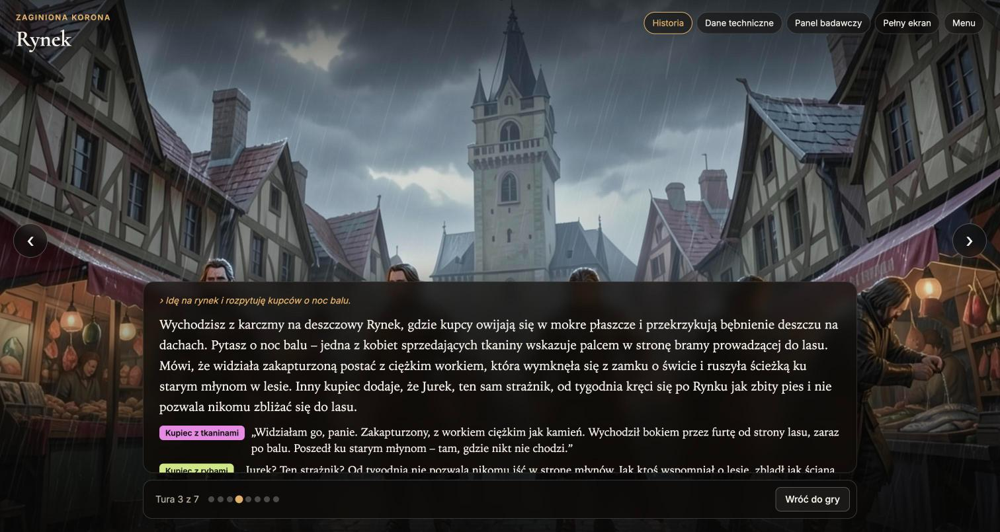
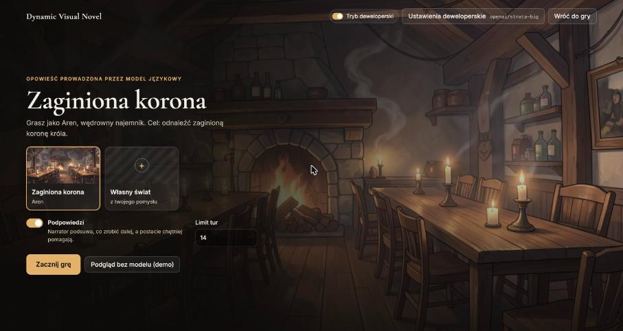

# Dynamic Visual Novel

Gra typu Visual Novel, w której fabułę, dialogi i obrazy tworzą na bieżąco modele AI.
Nie ma gotowych wyborów: gracz wpisuje własnymi słowami, co robi, a narrator opowiada, co dzieje się dalej.
Można też opisać własny pomysł na świat, a model zbuduje z niego całą przygodę.

Projekt na przedmiot *Eksploracja modeli i metod AI*.



**Poradnik krok po kroku ze zrzutami ekranu: [docs/poradnik.pdf](docs/poradnik.pdf)**

## Szybki start

Potrzebujesz [Docker Desktop](https://www.docker.com/products/docker-desktop/) i Gita. W terminalu wpisz:

```bash
git clone https://github.com/AntttPe/dynamic-visual-novel.git
cd dynamic-visual-novel
cp .env.example .env
docker compose up -d --build
```

Pierwsze uruchomienie trwa kilka minut. Potem otwórz **http://localhost:8000**.

| Chcę… | Co zrobić |
|---|---|
| tylko zobaczyć, jak to działa | kliknij **Podgląd bez modelu (demo)**, bez modelu i bez kluczy |
| grać na swoim API (OpenAI, Anthropic, Gemini, OpenRouter…) | w menu otwórz **Ustawienia deweloperskie**, wybierz „Inny model”, wpisz nazwę (np. `openai/gpt-4o-mini`) i klucz |
| grać na modelu zespołu | wklej plik `.env` od zespołu zamiast `cp .env.example .env` (model uczelni wymaga VPN) |
| grać na modelu na swoim komputerze | uruchom Ollamę ([instrukcja](docs/dla_zespolu.md#model-llama-ollama-opcjonalnie)) |

**Windows:** najpierw zainstaluj WSL2 (`wsl --install` w PowerShellu jako administrator), w Docker Desktop
włącz *Use the WSL 2 based engine* i *Resources > WSL Integration > Ubuntu*. Wszystkie komendy wpisuj
w terminalu **Ubuntu**, a projekt pobieraj do katalogu domowego (`cd ~`), nie na dysk `C:\`.

**Nigdy nie wrzucaj pliku `.env` na GitHuba.** Są w nim klucze (plik jest w `.gitignore`).

## Jak grać



1. W menu wybierz świat: gotową „Zaginioną koronę” albo **Własny świat** i wpisz kilka zdań pomysłu,
   np. `Cyberpunkowy Kraków w 2090 roku, jestem detektywką i szukam zaginionego androida`.
2. **Podpowiedzi** ułatwiają grę i pokazują następny krok w prawym górnym rogu. **Limit tur** jest opcjonalny.
3. Kliknij **Zacznij grę** i wpisz w polu na dole, co robisz. Enter wysyła.
4. Gra kończy się planszą **Wygrana** albo **Przegrana**, gdy osiągniesz cel świata albo coś pójdzie bardzo źle.

| Na ekranie gry | Co robi |
|---|---|
| **Historia** albo ← → | przewija wcześniejsze tury jak slajdy, Esc wraca do gry |
| **Pełny ekran** albo F | chowa przeglądarkę |
| suwak **↕** obok pola akcji | zmienia wysokość okna z tekstem |
| suwak **◐** obok pola akcji | widoczność okna z tekstem, gdy myszka jest poza nim |
| **Lektor** albo L | czyta tekst na głos: narrację lektor, kwestie postaci kobiecy albo męski głos (najlepiej brzmi w Edge) |
| **Panel badawczy**, **Dane techniczne** | czas, tokeny, stan świata, prompt i surowy JSON każdej tury |
| **Menu** | powrót do menu, gra zapisuje się sama |

**Zapisane gry.** W menu przycisk **Zapisane gry** pokazuje rozegrane gry. Wybrana gra otwiera się od pierwszej tury
w trybie historii (strzałki ← →), a **Wróć do gry** pozwala grać dalej. Działa po restarcie i bez serwera obrazów.
Zapis jest tylko na twoim komputerze, w katalogu `data/`.

Obrazy scen rysuje osobny serwer obrazów albo API obrazów (opis w [dokumentacji dla zespołu](docs/dla_zespolu.md#gra-z-obrazami-serwer-gpu-instytutu)).
Bez niego gra działa z samym tekstem.

## Najważniejsze komendy

| Co chcesz zrobić | Komenda |
|---|---|
| Uruchomić grę | `docker compose up -d` |
| Wstrzymać na przerwę / wznowić | `docker compose stop` / `docker compose start` |
| Pobrać nowszą wersję | `git pull`, potem `docker compose up -d --build` |
| Usunąć kontener (zapisane gry zostają) | `docker compose down` (bez `-v`) |
| Zobaczyć logi | `docker compose logs -f app` |
| Uruchomić testy | `docker compose exec app pytest -v` |

## Gdy coś nie działa

| Problem | Rozwiązanie |
|---|---|
| `Cannot connect to the Docker daemon` | Docker Desktop nie jest uruchomiony. Włącz go. |
| `port is already allocated` | Port 8000 jest zajęty. W `docker-compose.yml` zmień `"8000:8000"` na np. `"8080:8000"` i wejdź na localhost:8080 |
| Strona się nie otwiera | Poczekaj minutę i sprawdź `docker compose logs -f app` |
| Model nie odpowiada (kropka przy modelu nie jest zielona) | Sprawdź internet, VPN (model uczelni), klucz albo `ollama serve`. Do oglądania wystarczy demo |
| „Narrator nie zwrócił poprawnej odpowiedzi” | Model pomylił format JSON. Wyślij akcję jeszcze raz albo użyj większego modelu |
| Błąd 401 albo `AuthenticationError` przy własnym API | Zły klucz albo klucz do innego dostawcy niż przedrostek modelu (`openai/`, `anthropic/`…) |
| Własny serwer na komputerze nie odpowiada | W adresie użyj `host.docker.internal` zamiast `localhost` |
| Zmiany w kodzie nie restartują serwera | W `.env` ustaw `WATCHFILES_FORCE_POLLING=true` i uruchom ponownie |
| Dziwne błędy po zmianie bibliotek | `docker compose down`, `docker compose build --no-cache`, `docker compose up -d` |

## Dla zespołu

Wszystko poza samym graniem jest w **[docs/dla_zespolu.md](docs/dla_zespolu.md)**:

* własny świat i warunki końca gry w szczegółach,
* wybór modelu narratora, Ollama, własne API do tekstu i obrazów,
* gra z obrazami na serwerze GPU,
* eksperymenty i metryki (`app.eval`),
* agent Claude Code w kontenerze, struktura projektu, testy.

Stan projektu, zadania i dziennik zmian: [PROGRESS.md](PROGRESS.md). Zasady pracy dla agentów: [CLAUDE.md](CLAUDE.md).
Benchmark modeli obrazów: [bench/images/](bench/images/).
